# Lumi — Ruang Teduh & Jejak Harian 🌿🐻

<p align="center">
  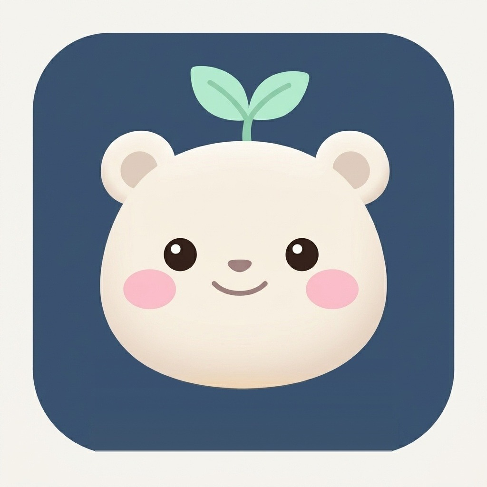
</p>

<p align="center">
  <b>Aplikasi Jurnal Kesehatan Mental, Pemantauan Ritme Sirkadian, Kepatuhan Rutinitas (Obat & Makan), serta Ringkasan Klinis Psikiater/Psikolog Berbasis Offline-First</b>
</p>

<p align="center">
  
  
  
  
  
</p>

---

## 🎬 Demo Video & Live Deployment

Tonton demonstrasi penggunaan atau coba langsung aplikasi **Lumi — Ruang Teduh & Jejak Harian** melalui tautan berikut:

- **🌐 Live Web App (GitHub Pages):** [https://zulfarida0107-crypto.github.io/Lumi-app/](https://zulfarida0107-crypto.github.io/Lumi-app/)
- **📦 GitHub Release (`v1.0.0`):** [https://github.com/zulfarida0107-crypto/Lumi-app/releases/tag/v1.0.0](https://github.com/zulfarida0107-crypto/Lumi-app/releases/tag/v1.0.0)
- **🎥 Demo Video File (Lokal / Repo):** [assets/UI/lumi_demo_video.mp4](assets/UI/lumi_demo_video.mp4)

<p align="center">
  <video src="assets/UI/lumi_demo_video.mp4" controls="controls" width="480" style="max-width: 100%; border-radius: 16px; box-shadow: 0 4px 20px rgba(0,0,0,0.15);">
    Browser Anda tidak mendukung tag video. Silakan unduh atau tonton langsung di <a href="assets/UI/lumi_demo_video.mp4">assets/UI/lumi_demo_video.mp4</a>.
  </video>
</p>

---

## ✨ Main Features

1. **Animated Mascot Splash & Multi-Layer Sanctuary Authentication:**
   - Animasi pembukaan interaktif maskot beruang **Lumi** dengan tunas daun mint yang tumbuh lembut.
   - Sistem keamanan berlapis yang mewajibkan registrasi akun terlebih dahulu, dilengkapi layar **Sambutan Hangat**, **Verifikasi Sidik Jari / Biometrik**, serta **Kunci PIN Privasi 4-Digit (Dialpad 3x4)**.
2. **Tab 1 — Hari Ini (Jejak Ritme Harian & 1-Tap Self-Care):**
   - Pemantauan waktu *real-time* WIB dengan *auto-reset* pergantian hari pukul `00:00 WIB` dan kalender strip mingguan interaktif.
   - **4 Kartu Jejak Utama:** Pencatatan **Minum Obat** (Pagi, Siang, Malam), **Jadwal Makan** (Pagi, Siang, Malam), **Durasi & Kualitas Tidur**, serta **Suasana Hati & Kapasitas Energi**.
   - **Mode Darurat 1-Tap ("Lagi Sangat Lelah"):** Memungkinkan penyintas depresi/kelelahan ekstrem mencatat kondisi harian hanya dengan satu sentuhan tanpa beban mengisi formulir panjang.
3. **Tab 2 — Catatan & Memori (Jurnal Harian & Mode Siap Konsultasi):**
   - Penulisan jurnal perasaan harian lengkap dengan lampiran dokumentasi foto, memo suara (*waveform*), label pemicu (*tags*), dan pencarian cepat.
   - **Pin Terapi (`⭐ Siap Konsultasi`):** Menandai catatan penting agar otomatis dirangkum saat sesi bersama psikolog atau psikiater.
   - **Fitur Mata Teduh (Privacy Blur):** Menyamarkan isi teks jurnal secara instan saat berada di ruang publik.
4. **Tab 3 — Matriks Bulanan, Year in Pixels & Ringkasan Konsultasi Dokter:**
   - **Kalender Bulanan Interaktif:** Menampilkan indikator suasana hati per tanggal (atau tanda `-` jika belum ada data) dan *bottom sheet* rincian harian saat tanggal diketuk.
   - **Wawasan Pola Otomatis (Dynamic Insights):** Menganalisis korelasi antara durasi tidur, kepatuhan minum obat, keteraturan makan, dan kestabilan afek secara dinamis.
   - **Ringkasan Konsultasi Dokter (`RingkasanKonsultasiScreen`):** Halaman laporan klinis terstruktur untuk psikiater/psikolog yang mencakup Matriks Klinis Utama, Sorotan Catatan Terapi, serta **Agenda Tanya Pasien ke Dokter** (mendukung tambah, ubah, dan hapus dengan konfirmasi).
   - **Sub-tab Tahunan (*Year in Pixels* & Kalender 12 Bulan):** Memvisualisasikan perjalanan emosi dan kualitas tidur selama 365 hari penuh.
5. **Tab 4 — Chart (Visualisasi Grafik Batang / Dynamic Bar Charts):**
   - **Bar Chart Jam Tidur & Mood Harian** dengan filter Mingguan (Minggu 1–4 & Sebulan Penuh) dan garis target tidur ideal `7 jam`.
   - **Grouped Bar Chart Kepatuhan Rutinitas (Obat vs Makan)** untuk waktu Pagi, Siang, dan Malam.
   - **Bar Chart Frekuensi Level Suasana Hati** (Level 1 *Berat* s/d Level 5 *Damai*) dan **Distribusi Kualitas Tidur**.

---

## 🔄 CRUD Operations Description

Aplikasi **Lumi** mengimplementasikan operasi **CRUD (Create, Read, Update, Delete)** secara menyeluruh yang terhubung langsung ke penyimpanan lokal (`SQLite` melalui `LumiDatabase`) dan *in-memory reactive state* (`LumiProvider`):

| Operasi | Modul / Entitas Data | Deskripsi Implementasi di Aplikasi Lumi |
| :--- | :--- | :--- |
| **CREATE** *(Tambah Data)* | **Akun Pengguna, Jejak Harian (`DailyJejak`), Catatan Jurnal (`NoteMemory`), & Agenda Dokter** | • Membuat akun baru pada `LumiRegisterScreen` (`LumiAuthStore.registerAccount`).<br>• Mencatat jam tidur, kualitas tidur, dan alasan pada modal *Catat Tidur* (`saveSleepRecord`).<br>• Menambahkan entri jurnal perasaan baru beserta mood, tag, foto, atau memo suara (`addNote`).<br>• Menambahkan pertanyaan baru pada bagian **Agenda Tanya Pasien ke Dokter** di halaman Ringkasan Konsultasi. |
| **READ** *(Baca & Visualisasi)* | **Linimasa Harian, Feed Catatan, Matriks Bulanan/Tahunan, & Bar Chart** | • Membaca data harian berdasarkan tanggal terpilih (`loadDataForDate`) dan menampilkannya pada kartu *Jejak Hari Ini*.<br>• Menampilkan dan memfilter daftar jurnal berdasarkan kata kunci pencarian, kategori *Siap Konsultasi*, *Low Energy*, Foto, atau Memo Suara.<br>• Mengagregasi data bulanan dan tahunan secara dinamis ke Kalender Bulanan, Matriks Klinis Dokter, *Year in Pixels*, dan *Bar Chart*. |
| **UPDATE** *(Perbarui Data)* | **Ceklis Rutinitas Obat/Makan, Catatan Jurnal, Nama Panggilan, & Agenda Dokter** | • Memperbarui status ceklis selesai (`✓`) atau terlewat (`✗`) beserta jam pelaksanaan pada jadwal Obat dan Makan (`toggleRoutineItem`, `saveRoutinesForType`).<br>• Mengubah isi catatan jurnal, level mood, dan status bintang *Pin Terapi* (`updateNote`, `togglePinNote`).<br>• Mengubah nama panggilan pengguna di layar Sambutan Hangat & tautan Google Spreadsheet di Pengaturan.<br>• Mengedit judul dan rincian pertanyaan pada **Agenda Tanya Pasien ke Dokter**. |
| **DELETE** *(Hapus Data)* | **Catatan Jurnal (`NoteMemory`), Reset Ceklis Harian, & Agenda Dokter** | • Menghapus catatan jurnal perasaan dari daftar dan database SQLite (`deleteNote`).<br>• Menghapus pertanyaan pada **Agenda Tanya Pasien ke Dokter** dengan pengaman **Popup Dialog Konfirmasi Hapus** agar tidak terhapus secara tidak sengaja.<br>• Membatalkan ceklis rutinitas harian sehingga hari tanpa rekaman otomatis dibersihkan dari koleksi aktif. |

---

## 🛠️ Technology

| Komponen | Teknologi / Pustaka | Kegunaan |
| :--- | :--- | :--- |
| **Framework UI** | [Flutter](https://flutter.dev/) (`SDK ^3.11.4`) | Pengembangan aplikasi lintas platform (Android, iOS, Windows, Web) dengan satu basis kode. |
| **Bahasa Pemrograman** | [Dart](https://dart.dev/) | Bahasa pemrograman utama untuk logika bisnis, model data, dan antarmuka reaktif. |
| **State Management** | [`provider`](https://pub.dev/packages/provider) (`^6.1.5+1`) | Mengelola *state* reaktif terpusat (`LumiProvider`) agar perubahan input langsung memperbarui Matriks dan Chart. |
| **Database Lokal** | [`sqflite`](https://pub.dev/packages/sqflite) (`^2.4.2+1`) & [`path`](https://pub.dev/packages/path) | Penyimpanan relasional SQLite *offline-first* di perangkat pengguna untuk tabel `daily_jejak` dan `notes`. |
| **Preferensi Lokal** | [`shared_preferences`](https://pub.dev/packages/shared_preferences) (`^2.5.6`) | Menyimpan konfigurasi ringan dan pengaturan pengguna di perangkat. |
| **Tipografi & Format Tanggal** | [`google_fonts`](https://pub.dev/packages/google_fonts) (`Plus Jakarta Sans`) & [`intl`](https://pub.dev/packages/intl) | Tipografi humanis yang menenangkan serta pemformatan waktu *real-time* WIB. |

---

## 🚀 Installation & Running Guide

Ikuti langkah-langkah berikut untuk menjalankan proyek **Lumi** di perangkat lokal Anda:

### 1. Prasyarat (*Prerequisites*)
- **Flutter SDK** versi `3.11.0` atau lebih baru (`flutter --version`).
- **Git** terpasang di komputer.
- **Android Studio** / **VS Code** beserta emulator Android, atau browser **Google Chrome** / **Microsoft Edge** / **Windows Desktop**.

### 2. Clone Repository & Instalasi Dependensi
```bash
# 1. Clone repository dari GitHub
git clone https://github.com/zulfarida0107-crypto/Lumi-app.git

# 2. Masuk ke direktori proyek
cd Lumi-app

# 3. Unduh seluruh paket dependensi Flutter
flutter pub get
```

### 3. Menjalankan Aplikasi
```bash
# Menjalankan di perangkat Android / Emulator yang terhubung
flutter run

# Menjalankan di Windows Desktop
flutter run -d windows

# Menjalankan di Browser Chrome
flutter run -d chrome
```

---

## 📦 Deployment / Release via GitHub

Aplikasi **Lumi** telah di-*deploy* secara langsung melalui **GitHub Pages** (untuk akses Web instan) dan **GitHub Releases** (untuk distribusi rilis versi `v1.0.0`):

- **Live Deployment (GitHub Pages):** [https://zulfarida0107-crypto.github.io/Lumi-app/](https://zulfarida0107-crypto.github.io/Lumi-app/)
- **Official Release (`v1.0.0`):** [https://github.com/zulfarida0107-crypto/Lumi-app/releases/tag/v1.0.0](https://github.com/zulfarida0107-crypto/Lumi-app/releases/tag/v1.0.0)
- **Source Repository:** [https://github.com/zulfarida0107-crypto/Lumi-app](https://github.com/zulfarida0107-crypto/Lumi-app)

### 1. Build File Release (APK / Web)
```bash
# Buat file APK Release untuk Android
flutter build apk --release

# Atau buat bundel Web Release untuk GitHub Pages
flutter build web --release --base-href "/Lumi-app/"
```

### 2. Publikasi ke GitHub Releases & GitHub Pages
1. Commit dan dorong (*push*) seluruh perubahan kode ke cabang utama GitHub:
   ```bash
   git add .
   git commit -m "chore(release): v1.0.0 Lumi Ruang Teduh & Jejak Harian"
   git push origin main
   ```
2. Buat *tag* versi rilis baru dan publikasikan ke GitHub Releases:
   ```bash
   git tag -a v1.0.0 -m "Release v1.0.0 — Lumi: Ruang Teduh & Jejak Harian"
   git push origin v1.0.0
   ```
3. Untuk pembaruan **GitHub Pages**, dorong hasil `build/web` ke cabang `gh-pages`:
   ```bash
   cd build/web
   git init -b gh-pages
   git add .
   git commit -m "deploy: Lumi Web release to GitHub Pages"
   git push -f https://github.com/zulfarida0107-crypto/Lumi-app.git gh-pages
   ```

---

## 📸 Documentation & Demo

Berikut dokumentasi antarmuka (*UI Screenshots*) dan penjelasan fungsional setiap modul pada aplikasi **Lumi**:

| No | Fitur & Modul | Dokumentasi Preview | Deskripsi Fungsional |
| :---: | :--- | :---: | :--- |
| **1** | **Animated Mascot Splash & Gerbang Autentikasi** | <table><tr><td align="center">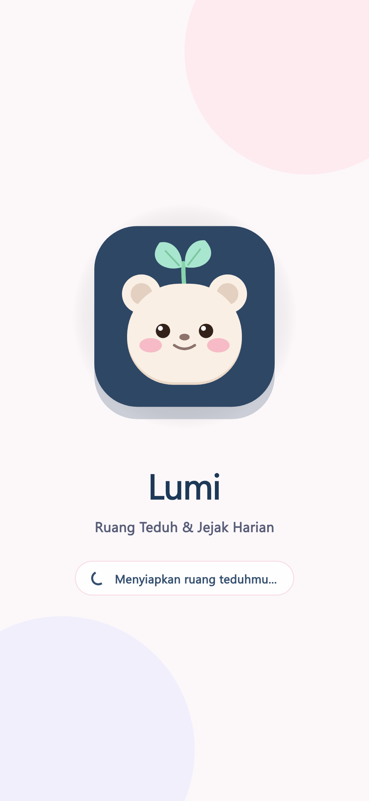<br><sub><b>Splash Screen</b></sub></td><td align="center">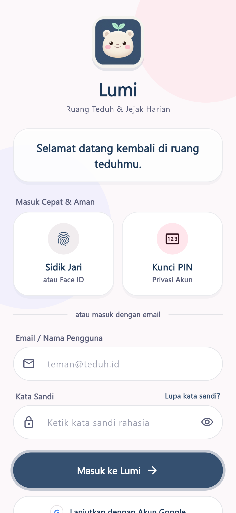<br><sub><b>Login Email</b></sub></td><td align="center">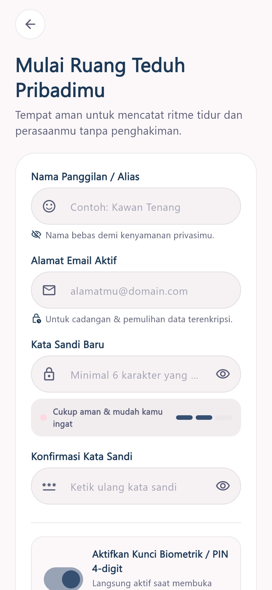<br><sub><b>Daftar Akun</b></sub></td><td align="center">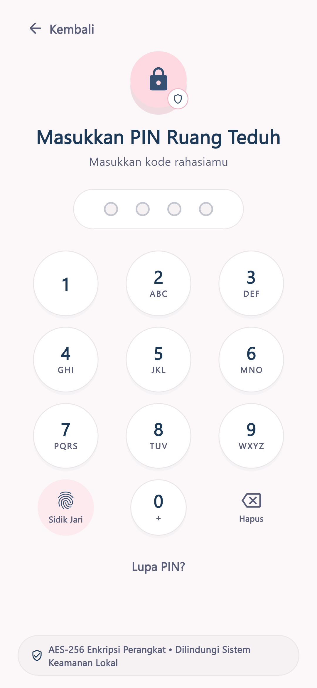<br><sub><b>Kunci PIN</b></sub></td></tr></table> | Layar pembuka animasi maskot beruang **Lumi** dengan tunas daun mint yang tumbuh lembut. Dilengkapi gerbang keamanan akun wajib (**Pendaftaran Akun Baru**, **Login Email**, **Kunci PIN 4-Digit**, **Autentikasi Biometrik/Sidik Jari**, dan **Layar Sambutan Personal**). |
| **2** | **Tab Hari Ini (Jejak Harian & 1-Tap Rutinitas)** | <table><tr><td align="center">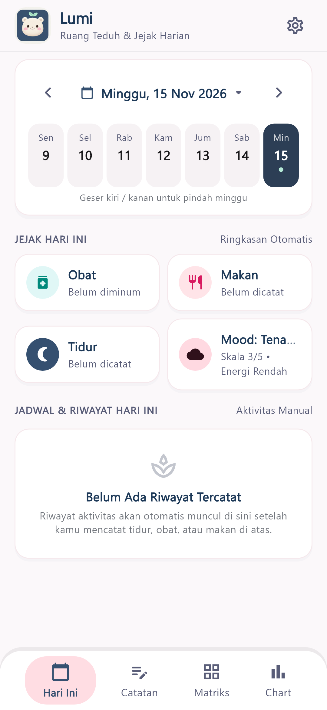<br><sub><b>Dashboard Utama</b></sub></td><td align="center">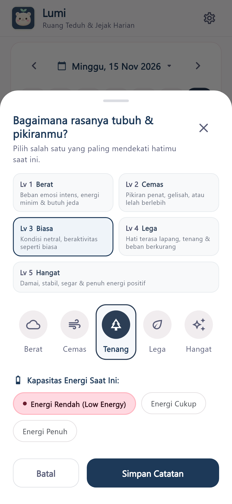<br><sub><b>Modal Mood & Energi</b></sub></td><td align="center">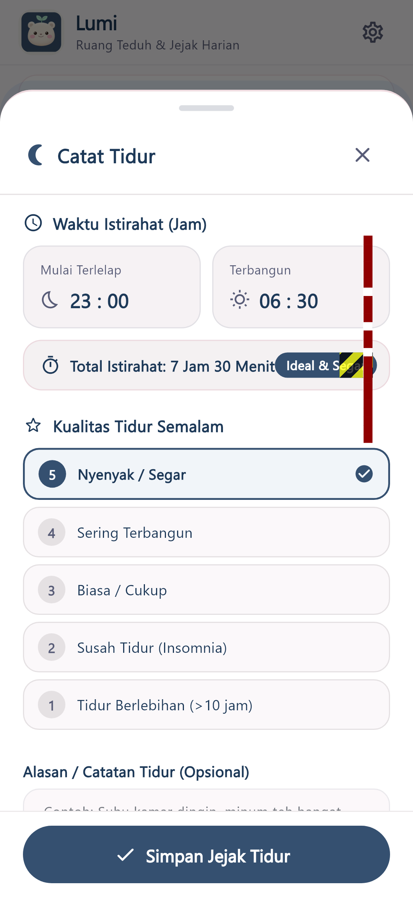<br><sub><b>Modal Catat Tidur</b></sub></td><td align="center">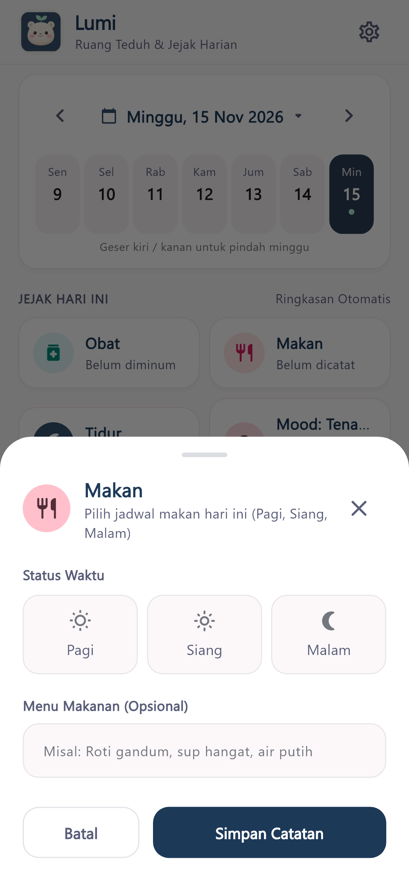<br><sub><b>Modal Makan</b></sub></td></tr></table> | Dashboard pemantauan harian *real-time* WIB dengan kalender mingguan geser interaktif, 4 kartu ringkasan (**Obat**, **Makan**, **Tidur**, **Mood**), tombol darurat **"Lagi Sangat Lelah"** (*1-Tap Low-Energy Mode*), serta modal cepat jadwal Pagi/Siang/Malam. |
| **3** | **Tab Catatan & Mode Siap Konsultasi** | <table><tr><td align="center">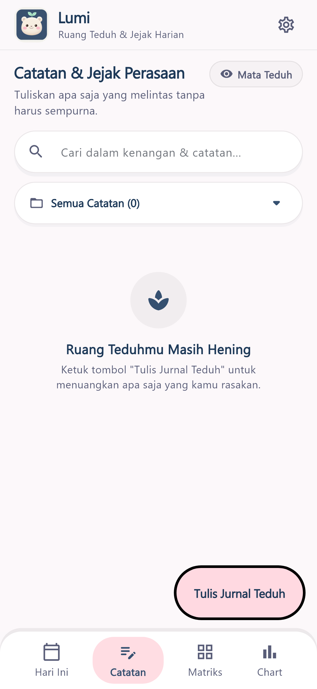<br><sub><b>Linimasa Catatan</b></sub></td><td align="center">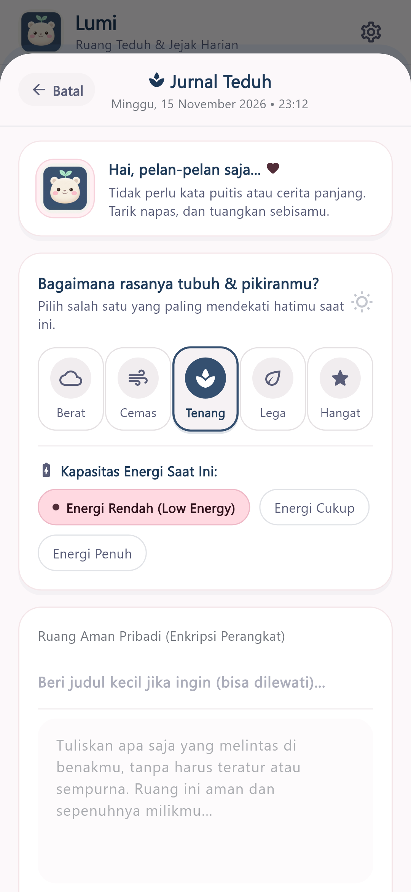<br><sub><b>Input Jurnal Teduh</b></sub></td></tr></table> | Linimasa jurnal perasaan dengan pencarian teks instan, filter kategori, penanda **⭐ Pin Terapi**, fitur privasi **Mata Teduh** (*blur kartu*), serta dukungan lampiran foto kenangan dan memo suara. |
| **4** | **Tab Matriks Bulanan & Year in Pixels** | <table><tr><td align="center">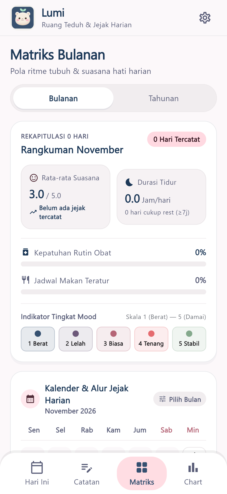<br><sub><b>Matriks Bulanan</b></sub></td><td align="center">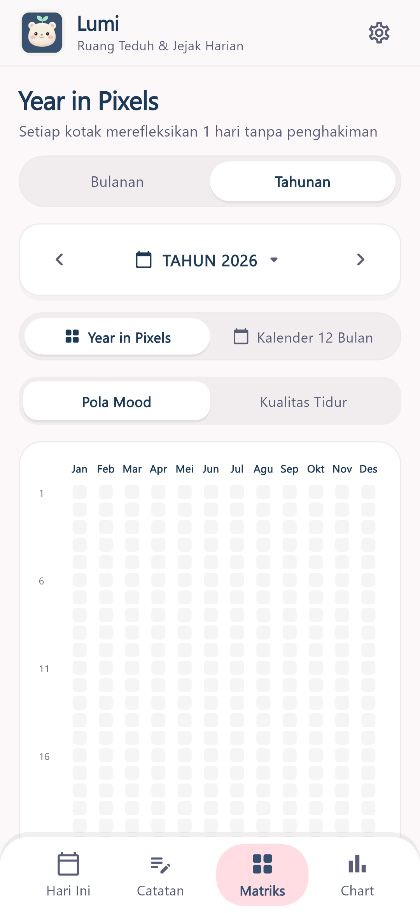<br><sub><b>Year in Pixels</b></sub></td></tr></table> | Kalender bulanan dengan indikator visual spektrum emosi harian (Level 1–5), analisis pola emosi otomatis, *bottom sheet* detail harian saat tanggal diketuk, serta rekapitulasi 365 hari dalam tampilan **Year in Pixels**. |
| **5** | **Ringkasan Konsultasi Dokter / Psikiater** | <table><tr><td align="center">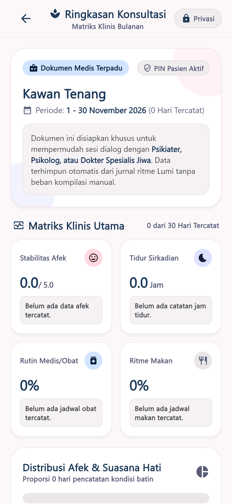<br><sub><b>Laporan Klinis</b></sub></td></tr></table> | Laporan klinis terstruktur yang merangkum **Matriks Klinis Utama** (Stabilitas Afek, Kualitas Tidur Sirkadian, Kepatuhan Obat, Keteraturan Makan), **Catatan Terapi**, serta **Agenda Tanya Pasien ke Dokter** lengkap dengan CRUD (Tambah, Edit, Hapus berkonfirmasi). |
| **6** | **Tab Chart (Visualisasi Grafik Interaktif)** | <table><tr><td align="center">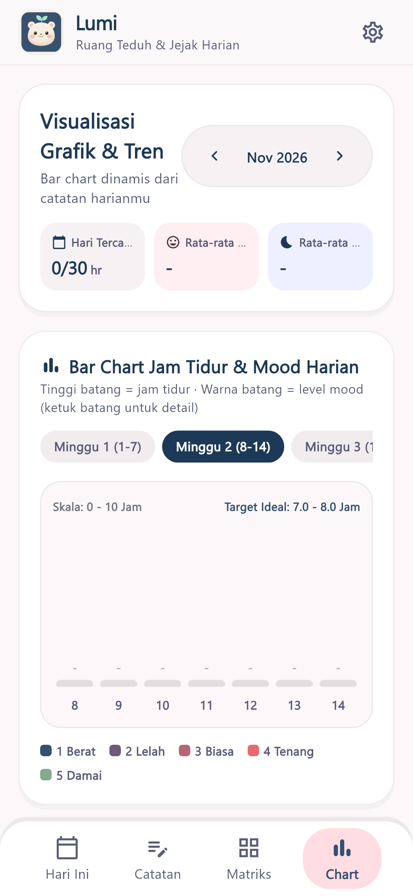<br><sub><b>Grafik Batang Dinamis</b></sub></td></tr></table> | Visualisasi grafik batang (*Bar Chart*) 100% dinamis yang memetakan **Durasi Tidur & Mood Harian**, **Grouped Bar Chart Obat vs Makan** (Pagi, Siang, Malam), **Frekuensi Level Mood**, dan **Distribusi Kualitas Tidur**. |
| **7** | **Pengaturan Privasi & Keamanan Ruang Teduh** | <table><tr><td align="center">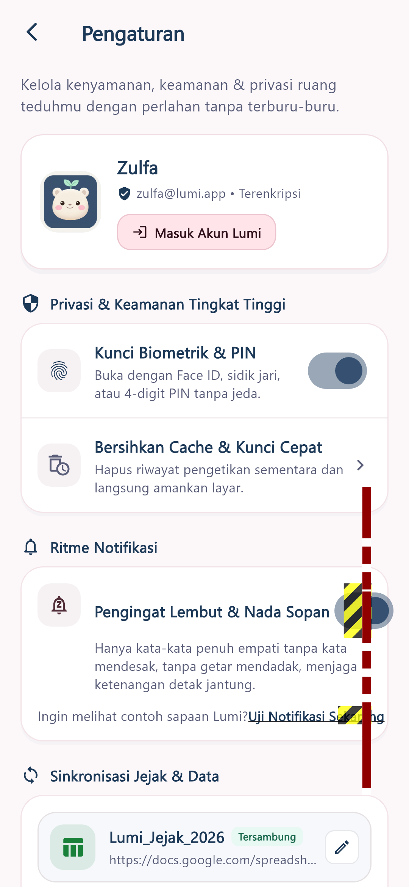<br><sub><b>Menu Pengaturan</b></sub></td></tr></table> | Personalisasi profil pengguna, saklar keamanan biometrik & PIN, manajemen pengingat lembut, integrasi Google Spreadsheet pribadi, ekspor data CSV/PDF, serta tombol pintas **Kunci Ruang Teduh Sementara**. |

### 🖼️ Galeri Lengkap Seluruh Antarmuka (18 Layar)

| Gerbang Autentikasi | Gerbang Autentikasi | Dashboard Harian | Tab Catatan |
| :---: | :---: | :---: | :---: |
| <br><b>01. Splash Screen</b> | <br><b>02. Login Email</b> | <br><b>07. Dashboard Hari Ini</b> | <br><b>08. Tab Catatan</b> |
| 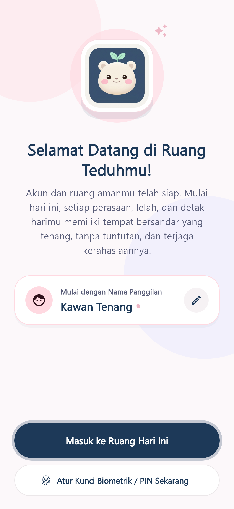<br><b>03. Welcome Sanctuary</b> | <br><b>04. Pendaftaran Akun</b> | <br><b>12. Modal Mood & Energi</b> | <br><b>16. Tulis Jurnal Teduh</b> |
| 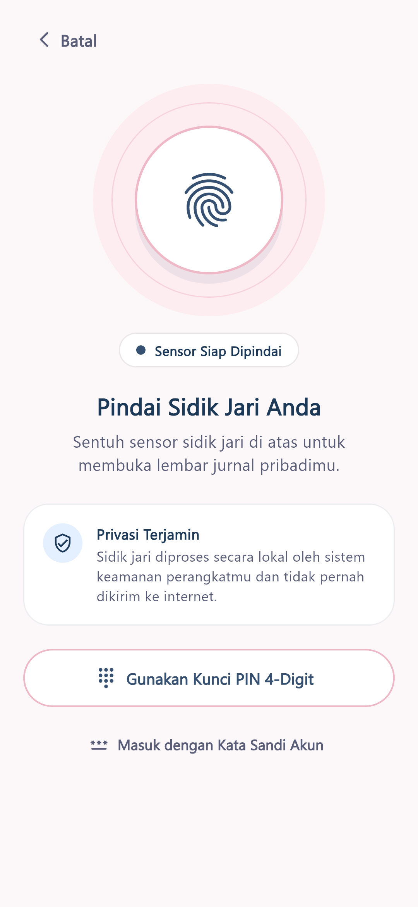<br><b>05. Kunci Sidik Jari</b> | <br><b>06. Kunci PIN</b> | <br><b>13. Modal Catat Tidur</b> | <br><b>14. Modal Jadwal Makan</b> |

| Analisis & Matriks | Laporan Medis & Grafik | Pengaturan & Profil | Modal Rutinitas |
| :---: | :---: | :---: | :---: |
| <br><b>09. Matriks Bulanan</b> | <br><b>17. Ringkasan Dokter</b> | <br><b>18. Pengaturan Akun</b> | 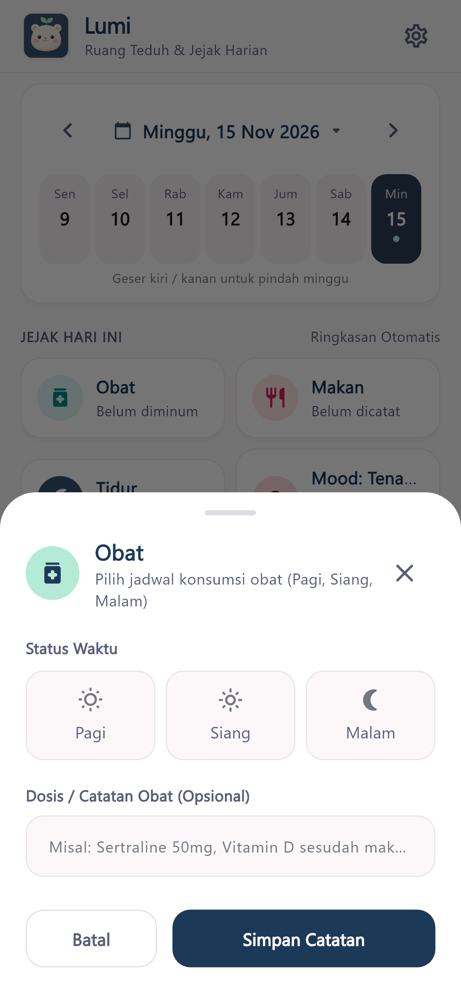<br><b>15. Modal Jadwal Obat</b> |
| <br><b>10. Year in Pixels</b> | <br><b>11. Chart & Analitik</b> | | |

---

<p align="center">
  Dibuat dengan penuh empati untuk menjaga setiap perasaan dan jejak harianmu tetap teduh. 🌿
</p>